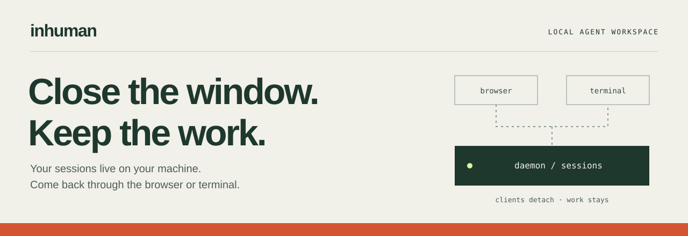
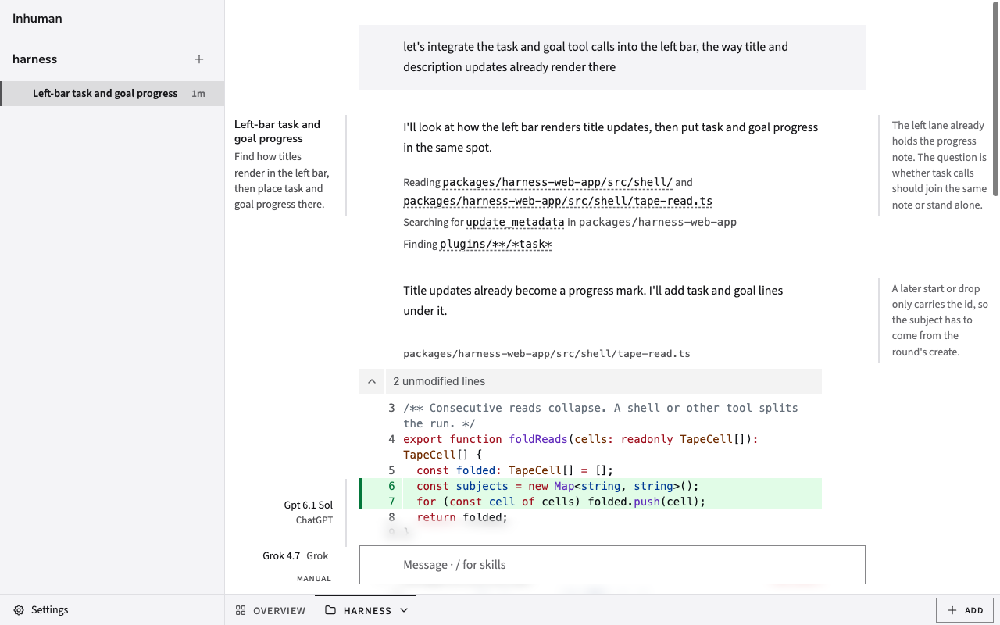

<p align="center">
  
</p>

<p align="center">
  <a href="https://github.com/here-build/inhuman-harness/actions/workflows/verify.yml"></a>
  <a href="https://www.npmjs.com/package/inhuman"></a>
  <a href="LICENSE.md"></a>
</p>

<p align="center">
  <a href="#start-a-session">Get started</a> ·
  <a href="docs/usage.md">User guide</a> ·
  <a href="docs/packages.md">Packages</a> ·
  <a href="CONTRIBUTING.md">Contribute</a>
</p>

# inhuman

**A local agent workspace that keeps running when you close the client.**

A background daemon owns your sessions. Open them in the browser or terminal,
connect a model, and give it work. Close the client and come back to the same
conversation. Your machine and daemon must stay running; pending approvals
still need you.

## Start a session

You need **Node.js 22+**, **macOS or Linux**, and access to a model provider.

```sh
npx inhuman web
```

1. On the first-run **Connect a model** screen, choose a provider and finish
   its sign-in or credential prompts. Later, add providers through
   **Settings → Connections → Add a model**.
2. Register a project by opening the terminal client in an existing folder:

   ```sh
   cd /path/to/your/project
   npx inhuman
   ```

   Replace the path with your folder. Once the terminal client opens, you can
   close it; the daemon keeps the project and session available.
3. Return to the browser, select the project's tab, and choose a model in the
   composer. Sending a message from the project page creates a session.
4. Send a first message: “Write a three-item project checklist. Reply here only;
   do not use tools or change files.”

`npx inhuman web` opens your browser and returns to your shell. The daemon and
web server keep running. Run it again to reopen your workspace.

Prefer the terminal? Run `npx inhuman`. See the [user guide](docs/usage.md) for
provider setup, choosing a project, resuming sessions, and troubleshooting.

## A workspace you can return to



*Browser client rendered from the repository's demo session fixtures. See
[media sources](docs/assets/README.md) for capture details.*

| What you want | What inhuman provides |
| --- | --- |
| Leave a task and come back | Sessions run in the background daemon, independently of the client. |
| Work in a browser or terminal | Both clients connect to the same daemon and session documents. |
| Choose your model | Connections for ChatGPT, OpenRouter, Grok, and OpenAI-compatible endpoints. |
| Decide which tools can act | Manual approval, policy-assisted auto mode, and always-approve mode with hard policy blocks. |
| Bring your own tools | MCP connections and plugin packs for additional capabilities. |

## Three ways to use it

**Explore a project.** Open the terminal client in a folder, then ask the agent to explain its README,
find an implementation, or trace a bug. Start with a read-only request and
review tool approvals as they appear.

**Continue a session.** Close the browser or terminal client, then reconnect
and select the session. Saved conversations live on your machine. Stopping the
daemon interrupts active execution; reopening a client does not approve
waiting tool calls.

**Connect your tools.** Add MCP servers with `npx inhuman mcp`, or install a
plugin pack with `npx inhuman install`. Start with the
[connection commands](docs/usage.md#everyday-commands). For developers, the
[hello plugin](examples/hello-plugin/README.md) is a complete installable example.
The [plugin SDK guide](packages/harness-plugin-sdk/README.md) covers the
JavaScript API and the current plugin loading boundary.

## Local by default

The browser server listens on loopback. The daemon stores configuration and
session documents in `~/.harness` by default. Model requests go to your chosen
provider; connected tools may use external services.

Remote access is **experimental and email-allowlisted**. It lets a signed-in
user control this machine's harness, including command-running tools. Read the
[remote access guide](docs/usage.md#remote-access-experimental) before enabling
it with `npx inhuman login`.

The project is under active development. Package APIs and plugin interfaces can
change; see the [package map](docs/packages.md) before adopting an SDK or
implementation package. Installation requirements and known operational
limits are in the [user guide](docs/usage.md).

## Build with us

- [Contributing](CONTRIBUTING.md) — source setup, checks, and releasing.
- [Package map](docs/packages.md) — the CLI, SDKs, libraries, and internal packages.
- [Package guidelines](docs/package-guidelines.md) — the standard for a consumer-ready package.
- [RPC contract](packages/harness-contract/spec/README.md) — the daemon's client interface.
- [Report a bug or suggest a feature](https://github.com/here-build/inhuman-harness/issues).

Report vulnerabilities to [security@here.build](mailto:security@here.build);
see [SECURITY.md](SECURITY.md).

[MIT](LICENSE.md) · Copyright 2026 Merkle Bonsai.
