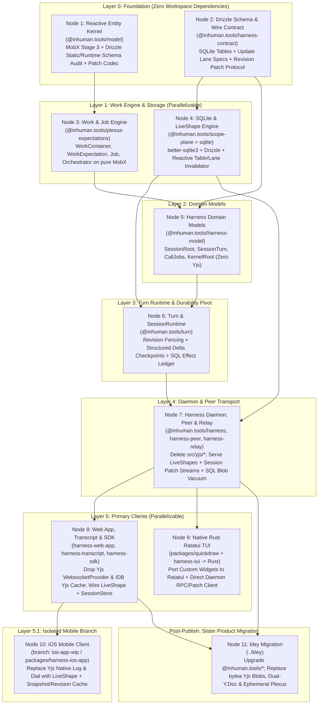

# Harness Architecture Rebuild: Strategy & Implementation DAG

## 1. Executive Summary & Foundational Principles

`@inhuman.tools/harness` was originally built on `@here.build/plexus` and **Yjs** (`Y.Doc`) as a unified reactive state and wire synchronization layer. While Yjs accelerated initial prototyping, a thorough audit of both `inhuman-harness-public` and its cloud counterpart `../kley` confirms that **a multi-writer CRDT is fundamentally mismatched to Harness's authority model**:

1. **Single-Writer Server Authority**: Clients (Web, TUI, Mobile, SDK) never mutate domain documents directly; every mutation enters through typed JSON-RPC commands (`turn/send`, `turn/cancel`, `ask/answer`, `ack/answer`, `kv/set`, `session/create`).
2. **Unbounded Monolithic Document Growth**: Packing the session roster (`KernelRoot`) and entire multi-turn execution histories (`SessionRoot`) into monolithic Yjs documents forces full-history binary hydration on startup, O(N) file scans during blob vacuuming (`vacuum.ts`), and repeated multi-megabyte `state bytea` WAL overwrites in `kley`.
3. **Client & Language Lock-in**: Coupling domain models to `PlexusModel` + `Y.Doc` requires dual-`Y.Doc` workarounds (`#wire` + `#doc` + manual `tick` counters) on read-only clients and blocks native non-JS clients (such as a standalone Rust `ratatui` TUI).

### Core Principles We Preserve
- **Explicit Work & Effect Graphs (`plexus-expectations` / PEW)**: `WorkContainer`, `WorkExpectation`, `Job`, and the reactive two-phase `Orchestrator` remain the heart of agent turn execution.
- **Durable Turn Ownership & Recovery (`@inhuman.tools/turn`)**: Incarnation fencing, idempotent effect ledgers, and deterministic checkpoint commits before external side-effects remain mandatory laws.
- **Fine-Grained MobX Reactivity**: Domain models stay reactive via native TC39 Stage 3 MobX decorators (`@observable.ref`, `@observable.shallow`, `@computed`, `@action`), with **zero local default drift** from the database schema.

---

## 2. Target Architecture: The Two-Plane State Model

Instead of treating all state as a single CRDT document, state is split into two explicit planes backed by **SQLite + Drizzle** locally (and **Postgres + ElectricSQL** in `kley`):

| Plane | Scope & Cardinality | Storage Source of Truth | Wire Transport | Client Reactivity |
| :--- | :--- | :--- | :--- | :--- |
| **1. Roster & Control Plane** | Kernel settings, session list/index (`running`, `title`, `mode`, `parentSessionId`, `updatedAt`), pending asks/acks, subagent call graph | Relational tables (`kernel_state`, `sessions`, `agent_calls`, `pending_asks`) | **Update Lanes (`LiveShape`)**: windowed, filtered row subscriptions (`active_sessions`, `recent_sessions`, `pending_asks`) | MobX `LiveShape` atom (`onBecomeObserved` / `onBecomeUnobserved`) |
| **2. Session Trajectory Plane** | Active session's `SessionTurn` list, PEW `WorkContainer` / `Job` tree, streaming thought/speech/tool output | Relational `session_turns` + append-only `session_updates (session_id, revision, patch_json)` | Multiplexed WebSocket (`text` = JSON-RPC, `patch` = incremental `(revision, patches[])` from `lastRevision`) | Native MobX `@model` / `@column` domain graph hydrated on demand |

---

## 3. Master Implementation DAG

---

## 4. Cluster Plan Index

Each implementation cluster in the DAG is documented in its own specification file in this directory:

1. **[01-node-1-reactive-entity-kernel.md](./01-node-1-reactive-entity-kernel.md)** — **Layer 0 / Node 1**: Pure MobX Stage 3 decorators (`@model`, `@column`, `@state`), static compile-time Drizzle schema type-checking, first-instantiation runtime SQLite schema auditing, zero local defaults, two-pass UUID reference hydration, and transaction patch recording.
2. **[02-node-2-schema-and-wire-contract.md](./02-node-2-schema-and-wire-contract.md)** — **Layer 0 / Node 2**: Canonical Drizzle SQLite schema (`kernel_state`, `sessions`, `session_turns`, `session_jobs`, `session_updates`, `session_blobs`, `pending_asks`), update lane definitions, and the `(revision, patches[])` wire contract.
3. **[03-node-3-work-and-job-engine.md](./03-node-3-work-and-job-engine.md)** — **Layer 1 / Node 3**: Migrating `packages/plexus-expectations` (`WorkContainer`, `WorkExpectation`, `Job`, `orchestrator.ts`, `kernel-intern.ts`) off `@here.build/plexus` while keeping 100% of orchestration and promise semantics intact.
4. **[04-node-4-storage-and-live-shape-engine.md](./04-node-4-storage-and-live-shape-engine.md)** — **Layer 1 / Node 4**: Local SQLite + Drizzle storage engine, transaction commit hooks, update lane query planner, and MobX `LiveShape` client/server primitives.
5. **[05-node-5-harness-domain-models.md](./05-node-5-harness-domain-models.md)** — **Layer 2 / Node 5**: Migrating `packages/harness-model` (`SessionRoot`, `SessionTurn`, `CallJob` subclasses, `KernelRoot`) and replacing `SessionPlexus` / `KernelPlexus` with `SessionDocument` / `KernelDocument`.
6. **[06-node-6-turn-runtime-and-durability.md](./06-node-6-turn-runtime-and-durability.md)** — **Layer 3 / Node 6**: Refactoring `packages-runtime/turn` (`SessionRuntime`, `SessionDurability`, `SessionCheckpoint`, recovery, effect dedup ledger) from `Y.Doc` binary snapshots to incremental `(revision, delta, summary)` checkpoints.
7. **[07-node-7-daemon-and-peer-transport.md](./07-node-7-daemon-and-peer-transport.md)** — **Layer 4 / Node 7**: Refactoring `packages/harness`, `harness-peer`, and `harness-relay`—removing `src/yjs/*`, serving `LiveShape` lanes and session patch streams, and replacing `.yjs` file scanning in `vacuum.ts` with relational queries.
8. **[08-node-8-web-and-sdk-clients.md](./08-node-8-web-and-sdk-clients.md)** — **Layer 5 / Node 8**: Migrating `harness-web-app`, `harness-transcript`, `harness-client`, and `harness-sdk`—replacing `y-websocket` and `doc-cache.ts` with `LiveShape` + `SessionStore`.
9. **[09-node-9-rust-ratatui-and-widgets.md](./09-node-9-rust-ratatui-and-widgets.md)** — **Layer 5 / Node 9**: Consolidating `packages/harness-tui` and `packages/quickdraw` (`rust/qd`) into a standalone Rust `ratatui` application, including the widget-by-widget migration plan for all custom TUI widgets.
10. **[10-layer-5-1-mobile-ios-app.md](./10-layer-5-1-mobile-ios-app.md)** — **Layer 5.1 / Node 10**: Migrating `packages/harness-ios-app` on branch `ios-app-wip`—replacing the native base64 Yjs update log (`doc-cache.ts`, `doc-log.ts`, `HarnessHost.m`) and `Dial` with `LiveShape` and revision-based snapshot caching.
11. **[11-post-publish-kley-migration.md](./11-post-publish-kley-migration.md)** — **Post-Publish / Node 11**: Migrating `../kley` after publishing the new `@inhuman.tools/*` packages—eliminating `system.assistant_session_doc` `bytea` rewrites, the client dual-`Y.Doc` `#wire`/`#doc` hack, and ephemeral `SessionPlexus` in `@kley/execution`.
