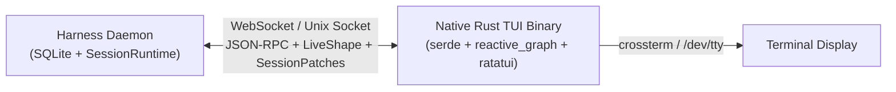

# Node 9: Native Rust `ratatui` TUI & Custom Widget Migration

**DAG Position**: Layer 5 (Depends on Node 2 Wire Contract and Node 7 Daemon Transport)  
**Packages Replaced / Consolidated**: `packages/harness-tui` (TypeScript + MobX-State-Tree) and `packages/quickdraw` (`src/` TS widgets + `rust/qd` custom renderer) $\rightarrow$ unified native Rust TUI binary (`packages/quickdraw/rust/qd` / `harness-tui-rs`)

---

## 1. Current Architecture vs. Target Architecture

### How It Works Today (Split-Brain Node.js $\leftrightarrow$ Rust Pipe)
Today, the TUI is split across two processes and three state trees:
1. **Daemon (`SessionRoot` in Yjs/Plexus)** syncs over WebSocket into **Node.js `harness-tui`** (`tea.ts` — 108 KB state machine).
2. **Node.js `harness-tui`** projects state into a **MobX-State-Tree `PaintNodeInstance` DOM** (`paint-dom.ts`), runs MobX reactions (`paint-widgets.ts`) to build retained TS `quickdraw` widgets (`packages/quickdraw/src/widgets/*`), and serializes `paint_init` / `paint_patch` JSON frames over stdio (`rust-present.ts`).
3. **Child Rust process `qd`** (`packages/quickdraw/rust/qd/src/`) decodes the replica (`paint_replica.rs` — 148 KB!), runs a hand-rolled flexbox/text layout engine (`layout_engine.rs`, `layout_flex.rs`, `layout_chrome.rs`, `layout_hit.rs`, `layout_text.rs`), and paints to `/dev/tty` (`present.rs`, `buffer.rs`).

### Target Architecture: Pure Native Rust (`ratatui` + `reactive_graph`)
Because Node 2 and Node 7 replace Yjs/Plexus with clean **JSON-RPC + `LiveShape` lanes + `(revision, patches[])` session streams**, the entire Node.js `harness-tui` middleman (`tea.ts`, `paint-dom.ts`, `paint-widgets.ts`, `rust-present.ts`) and the `paint_init`/`paint_patch` stdio replication protocol are eliminated:

1. **State & Reactivity Layer (`reactive_graph` + `slotmap`)**:
   - Incoming `ShapeDeltaFrame` (`active_sessions`, `recent_sessions`, `pending_asks`, `child_sessions`) and `SessionSyncFrame` (`session/snapshot`, `session/patch`) deserialize via `serde` directly into arena-backed Rust structs wrapped in `RwSignal<T>` and `Memo<T>`.
2. **Layout & Rendering Layer (`ratatui`)**:
   - Replaces the 320+ KB of custom layout code (`layout_engine.rs`, `layout_flex.rs`, `layout_chrome.rs`, `paint_replica.rs`) with `ratatui::layout::Layout`, `Buffer`, `Rect`, and `StatefulWidget` while preserving the exact visual precision, hit-testing, and terminal capability handling of `qd`.

---

## 2. Custom Widget Migration Matrix ( onto `ratatui` )

Every custom widget currently split across `packages/harness-tui/src/tui/*`, `packages/quickdraw/src/widgets/*`, and `packages/quickdraw/rust/qd/src/*` is ported into a modular `ratatui::widgets::StatefulWidget` / `Widget` in Rust:

| Custom Widget / Feature | Current Source Files | Target Rust `ratatui` Widget Module | Key Capabilities Preserved in `ratatui` |
| :--- | :--- | :--- | :--- |
| **1. Transcript Column & Tape Spans** | `quickdraw/src/widgets/transcript.ts`, `harness-tui/src/tui/tape-spans.ts`, `qd/src/present.rs` | `widgets::transcript::TranscriptWidget` (`StatefulWidget`) | Virtualized bottom-pinned scroll viewport, thought clock clustering (`clusterThoughtClock`), fused tool filtering (`filterFusedTools`), and smooth scroll physics. |
| **2. User & Assistant Speech Rails** | `quickdraw/src/widgets/speech.ts`, `markdown.ts`, `qd/src/layout_text.rs` | `widgets::speech::SpeechWidget` + `widgets::markdown::MarkdownStream` | Left rail geometry (`userSpeechRailWidth` / `replySpeechRailWidth`), streaming markdown parser (`pulldown-cmark` / incremental span builder), and Unicode grapheme wrapping (`unicode-segmentation`, `unicode-width`). |
| **3. Thinking Stream & Birth Animation** | `quickdraw/src/widgets/shadow-stream.ts`, `stream-birth.ts`, `qd/src/birth.rs`, `expand.rs` | `widgets::thinking::ThinkingStreamWidget` | Collapsible reasoning trace, birth fade-in/reveal animation (`birth.rs`), and live elapsed thought timer. |
| **4. Work Cells & Tool Disclosures** | `harness-tui/src/tui/work-cells.ts`, `qd/src/expand.rs`, `paint_widget.rs` | `widgets::work_cell::WorkCellWidget` | Expand/collapse disclosure triangles, tool call status badges (running spinner, success, failure, cancelled), and inline receipt summaries. |
| **5. Syntax Highlighting & Pierre Diff** | `qd/src/syntax.rs`, `syntax_diff.rs`, `pierre.rs`, `quickdraw/src/widgets/diff.ts` | `widgets::code::SyntaxWidget` & `widgets::diff::PierreDiffWidget` | **Already in Rust (`tree-sitter` in `qd/src/syntax.rs`, `syntax_diff.rs`, `pierre.rs`)!** Adapt output directly to `ratatui::text::Line` / `Span` with light/dark `SyntaxPolarity` themes. |
| **6. Omnibox / Composer Frame & Command Picker** | `harness-tui/src/tui/omnibox-seat.ts`, `quickdraw/src/widgets/composer-*.ts`, `qd/src/composer_command.rs`, `draft.rs` | `widgets::composer::ComposerWidget` + `ComposerCommandPopup` (`Clear` + overlay `Rect`) | Multi-line text editor with grapheme-aware caret (`composer-caret.ts`), click-to-place cursor (`composer-click.ts`), `/command` & `@file` autocomplete popup (`composer-picker.ts`), and queue/steer shortcuts. |
| **7. Agents Drawer (Subagent Tree)** | `harness-tui/src/tui/agents-drawer.ts`, `qd/src/drawers.rs` | `widgets::drawers::AgentsDrawerWidget` | Subscribes to `child_sessions` + `active_sessions` lanes; renders parent/child agent call tree, live status spinners, and focus switching between parent and worker sessions. |
| **8. Ask / Ack Prompts & Permissions View** | `harness-tui/src/tui/ack-prompt.ts`, `ask-shortcuts.ts`, `permissions-view.ts` | `widgets::prompts::AskPinWidget` & `widgets::permissions::PermissionsModal` | Inline pinned approval prompt (`y/n/comment`) bound to `session/ask/answer` & `session/ack/answer` RPCs, plus the interactive permission rules inspector. |
| **9. Rewind Chrome & Recall** | `harness-tui/src/tui/rewind-chrome.ts`, `quickdraw/src/widgets/index.ts` (`Recall`) | `widgets::rewind::RewindChromeWidget` & `RecallWidget` | Turn history scrubber/selector calling `turn/rewind` & `turn/retry` RPCs. |
| **10. Statusline, Spinner & Wait Phrase** | `harness-tui/src/tui/statusline-path.ts`, `spinner-phase.ts`, `wait-phrase.ts` | `widgets::statusline::StatuslineWidget` | Bottom chrome bar showing workspace path, active model, permission mode, token/activity metrics, and animated spinner phase. |
| **11. Mouse Hit-Testing, Selection & Copy Toast** | `qd/src/layout_hit.rs`, `selection_host.rs`, `copy_toast.rs`, `capabilities.rs` | `interaction::SelectionHost` & `widgets::toast::CopyToastWidget` | Keeps `qd`'s existing Rust `selection_host.rs`, `copy_toast.rs`, and OSC-52 clipboard integration (`capabilities.rs`), mapping hit regions from `ratatui::layout::Rect` Registry during render. |
| **12. VT Terminal Embed (Shell Output)** | `harness-tui/src/tui/vt-paint.ts`, `qd/src/embed.rs` | `widgets::vt_embed::VtEmbedWidget` | Renders embedded ANSI/VT terminal buffers from running `ShellJob` instances directly into a `ratatui::buffer::Buffer` slice. |

---

## 3. Preserving Visual Snapshot Tests (`__visual__`)

`packages/harness-tui/src/tui/__visual__` and `packages/quickdraw/src/__visual__` contain deterministic terminal frame snapshot tests (`present_dump.rs` / `terminal-matcher.ts`).
- Because `ratatui::Terminal::with_backend(TestBackend::new(cols, rows))` renders deterministically into an in-memory `Buffer` without a real TTY, we keep `present_dump.rs` on top of `ratatui`'s `Buffer` so all visual regression tests run directly in `cargo test` in milliseconds!

---

## 4. Verification Criteria for Node 9

- [ ] All 12 custom widget families render inside `ratatui` with `TestBackend` visual snapshot parity against existing `__visual__` golden frames.
- [ ] `tree-sitter` syntax highlighting (`syntax.rs`), side-by-side/unified diffs (`syntax_diff.rs`, `pierre.rs`), mouse text selection (`selection_host.rs`), and terminal capabilities (`capabilities.rs`) work natively in the Rust `ratatui` loop.
- [ ] `packages/harness-tui` no longer runs a Node.js React/MST/TEA intermediate process; the Rust binary connects directly to the Harness Daemon socket.
