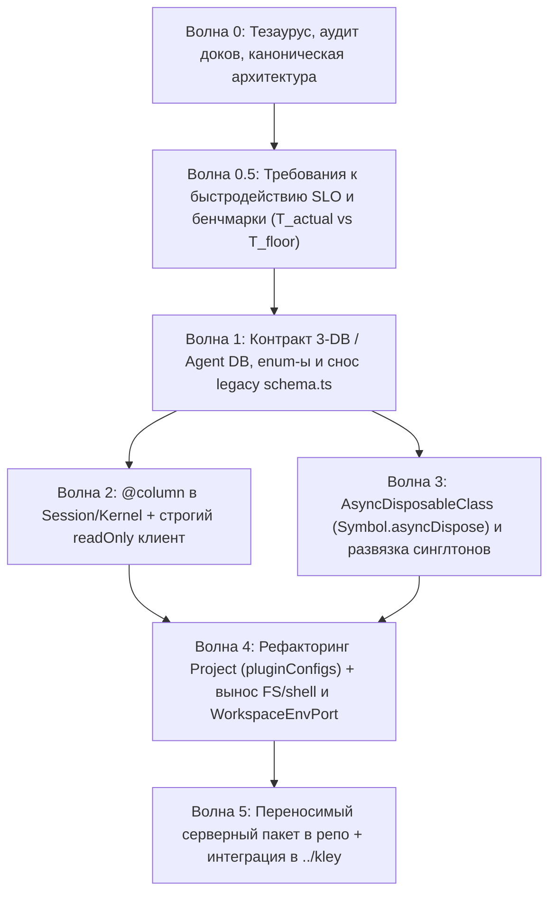

# Единая архитектура: Client (`Local Contour`) + Portable Multi-Tenant Server (`Server Contour`)

Этот документ фиксирует целевую архитектуру `inhuman-harness-public` после завершения миграции с `Yjs`/`Plexus` и подготовки переносимой серверной инсталляции (включая `../kley` как облачного потребителя). Словарь понятий — в [тезаурусе](thesaurus.md).

---

## 1. Трехбазовая топология хранения (`Server Contour`) и выбор SQLite vs PGlite

### 1.1. Три изолированные БД на сервере

```text
  +--------------------------+        +-----------------------------------+
  |  Product DB(s)           |        |  Dedicated Secrets DB             |
  |  (e.g. Kley control DB + |        |  (postgres-secrets)               |
  |   per-team t_<md5> DBs)  |        |  AES-256-GCM + AAD(tenant,kernel) |
  +------------+-------------+        +-----------------+-----------------+
               | tools / project plugins                | SecretsVaultPort
               v                                        v
  +-----------------------------------------------------------------------+
  |  Portable Multi-Tenant Harness Server                                 |
  |  MultiKernelRegistry -> KernelDaemon -> ProjectDaemon -> SessionDaemon|
  |  Strict AsyncDisposable (Symbol.asyncDispose) + IDLE_EVICT_MS         |
  +----------------------------------+------------------------------------+
                                     | Drizzle (Postgres) + ElectricSQL / WS
                                     v
  +-----------------------------------------------------------------------+
  |  Dedicated Agent DB (postgres-agent)                                  |
  |  kernel_state, projects, scope_nodes, sessions, pending_asks,         |
  |  session_turns, session_nodes, session_effects, session_blobs,        |
  |  scm_resources, plugin_state_logs   -- все разделено по kernel_id     |
  +-----------------------------------------------------------------------+
```

- **Выделенная мульти-тенантная `Agent DB` (`postgres-agent`)**: хранит агентные сессии, узлы, задачи и `.scm`-ресурсы всех пользователей в одной специализированной БД, физически отделенной от продуктовых баз (`t_<md5>` в Клее остаются для пользовательских таблиц команд) и от `Secrets DB`. Это позволяет изолировать I/O нагрузку агента, выносить `Agent DB` на отдельный хост и при необходимости включать `wal_level = logical` для ElectricSQL только на этой базе.
- **Переносимый сервер в самом репозитории**: модули мульти-тенантного реестра, Postgres/S3/Secrets-портов и HTTP/WS роутера собираются в пакете `@inhuman.tools/harness` (или выделенном серверном экспорте) так, чтобы его можно было запустить как самостоятельный self-hosted сервис или подключить в `../kley` без форка рантайма.

### 1.2. Почему в `Local Contour` сохраняется `better-sqlite3`, а не `PGlite`

1. **ElectricSQL не может реплицироваться с `PGlite` как upstream-источника**: сервер синхронизации Electric читает поток логической репликации PostgreSQL (`wal_level = logical`, `walsender`). Однопроцессный WASM-инстанс PGlite может работать только как *потребитель* синка (`@electric-sql/pglite-sync`), но не как источник данных для облачных клиентов.
2. **Цена локального оверхеда**: WASM PGlite добавляет ~150–400 мс холодного старта CLI, ~35–70 МБ RSS на процесс и ограничение single-process file lock, тогда как `better-sqlite3` в режиме WAL стартует за ~1–5 мс и допускает одновременный доступ утилит и демона.
3. **Итог**: локально остается **SQLite WAL (`better-sqlite3`)**; на сервере — **PostgreSQL + Drizzle** с единым контрактом строк и схем в `@inhuman.tools/harness-contract`. `PGlite` допустим только как опциональный быстрый драйвер в Vitest-тестах Postgres-адаптера.

---

## 2. Целевая схема `Agent DB` и выравнивание словарей

Волна 1 устраняет дрейф между `packages/harness-contract/src/schema/{sqlite,postgres}.ts`, `packages/scope-plane/src/schema.ts` и доменными моделями:

1. **Упразднение `'singleton'`**:
   - `kernel_state` использует `kernel_id TEXT PRIMARY KEY` (`'local'` для CLI, `userId`/`tenantId` на сервере).
   - Во все корневые и сессионные таблицы (`scope_nodes`, `sessions`, `pending_asks`, `session_turns`, `session_nodes`, `session_effects`, `session_blobs`) добавляется `kernel_id` и индекс с `kernel_id` первым ключевым полем.
2. **Таблица `projects`**:
   - `projects (kernel_id, project_id PRIMARY KEY, title, kind, default_permission_mode, authorization_json, kvs_json, last_used_model_json, enabled_plugins_json, plugin_configs_json, bots_roster_json, trusted, content_hash, revision, updated_at_ms)`.
   - Таблица `sessions` ссылается на `project_id TEXT NOT NULL DEFAULT ''` вместо `workspace_path` как идентификатора проекта.
3. **Серверные таблицы вместо локальной ФС**:
   - `scm_resources (id PRIMARY KEY, kernel_id, scope, scope_id, kind ['policy' | 'bot' | 'command' | 'behavior'], name, source, sha256, updated_at_ms)` — хранит `.scm`-политики и `.prompt`/`.scm`-ресурсы ботов на сервере вместо файлов на диске.
   - `plugin_state_logs (id PRIMARY KEY, kernel_id, plugin, scope ['project' | 'global'], scope_id, namespace, log_json, updated_at_ms)` — хранит `project`/`global` состояния Scheme-редьюсеров (`tasks`, `offload-tingle` и др.), которые в `Local Contour` пишутся `FsStateStore` в `plugin-state/*.json` ([state-store.ts](../../packages/harness/src/extensions/state-store.ts#L65-L77)).
4. **Выравнивание enum-ов**:
   - `permission_mode`: дефолт в `sqlite.ts` и `postgres.ts` меняется с `'ask'` на `'manual'` (`'manual' | 'auto' | 'yolo'`).
   - `mode` в `SessionRoot` выравнивается с wire-контрактом (`'assistant' | 'agentic'`).
5. **Единый источник схемы**: старая 10-табличная схема `packages/scope-plane/src/schema.ts` удаляется; `scope-plane-electric` и `scope-plane-tinybase` переводятся на `@inhuman.tools/harness-contract/schema`.

---

## 3. Жизненный цикл и выгрузка из RAM (`Symbol.dispose` / `Symbol.asyncDispose`)

Для мульти-тенантного процесса критична гарантированная выгрузка неактивных ядер, проектов и сессий из оперативной памяти без гонок и утечек глобальных ссылок:

1. **`AsyncDisposableClass`** в `@inhuman.tools/harness-commons` ([disposable.ts](../../packages/harness-commons/src/disposable.ts)):
   - идемпотентный `[Symbol.asyncDispose](): Promise<void>`, сохраняющий единый `Promise` архивации (`#disposing`), чтобы таймер вытеснения (`IDLE_EVICT_MS`) и остановка сервера не запускали двойной flush/park;
   - совместимость с `@disposableGuard`.
2. **Каскад владения**:
   - `MultiKernelRegistry` (счетчик активных WS-клиентов и активных turn-ов, таймер `IDLE_EVICT_MS`) → `await kernel[Symbol.asyncDispose]()`.
   - `KernelDaemon` (`AsyncDisposable`) → архивирует все `ProjectDaemon`, закрывает пулы провайдеров и публичные MCP-соединения, сбрасывает `kernel_state`.
   - `ProjectDaemon` (`AsyncDisposable`) → паркует и выгружает `SessionDaemon`, вызывает `await plugin[Symbol.asyncDispose]()` у всех активированных проектных плагинов (освобождая ВМ/VFS-лизы и приватные MCP).
   - `SessionDaemon` (`AsyncDisposable`) → `park()`, финальный flush `ScopePlane` в БД, закрытие стримов/буферов.
3. **Развязка процессных синглтонов**:
   - `blobs/store.ts` (`let seated`), `visual-store.ts` (`let rootDir`) и `secrets.ts` переносятся в контекст инстанса `KernelDaemon` / порт-интерфейсы (`BlobBucket`, `VisualStore`, `SecretsVaultPort`). После вызова `await kernel[Symbol.asyncDispose]()` ни один глобальный модуль процесса не удерживает ссылки на ресурсы выгруженного ядра.

---

## 4. `KernelReflector` vs БД + двухуровневая система плагинов

### 4.1. Сохранение `KernelReflector` на клиенте и отказ на сервере

| Компонент | `Local Contour` | `Server Contour` |
| --- | --- | --- |
| Настройки и гранты | `KernelReflector` ([reflectKernel.ts](../../packages/harness/src/server/daemon/kernel/fs-reflection/reflectKernel.ts)) активен; синхронизирует `config.json`, `grants.json`, `kv.json`, `.scm` | Отключен; конфигурация и `.scm` читаются/пишутся напрямую в `kernel_state`, `projects` и `scm_resources` |
| Стейт плагинов (`StateStore`) | `FsStateStore` (`plugin-state/*.json` + `SessionRoot.pluginState`) | `DbStateStore` (`plugin_state_logs` + `SessionRoot.pluginState`) |
| Блобы и визуалы | `FsBlobBucket` в `~/.harness/blobs` и `visual/` | `S3BlobBucket` / CAS с привязкой к `kernel_id` |

### 4.2. Плагины рантайма (`inhuman`-плагины) vs пользовательские расширения

- **`inhuman`-плагины на сервере — только общие (host-bundled)**: хост регистрирует неизменяемый `HostRuntimePluginCatalog` (`tasks`, `goal`, `fusion`, `offload-tingle`, `file-runtime`, `vfs-env` / `sandbox-env`, продуктовые плагины хоста).
  - Клиенты/тенанты могут **включать/выключать** нужные плагины на уровне `Kernel` и переопределять на уровне `Project`, но не устанавливают свои npm-плагины или хостовый JS.
  - `repin()` в [host.ts](../../packages/harness/src/extensions/host.ts#L151-L184) для хост-плагинов читает исходники из иммутабельного кэша сборки без `readFileSync` с диска.
- **Пользовательские расширения** (`SKILL.md`, внешние HTTP/SSE MCP-серверы с OAuth/ключами в `Secrets DB`, команды, декларативные промпты) остаются полностью управляемыми каждым пользователем.

---

## 5. `Project` как конфиг-оверлей и `FS + shell` как стандартный `inhuman`-плагин

### 5.1. Переосмысление `Project`

`ProjectDaemon` ([ProjectDaemon.ts](../../packages/harness/src/server/daemon/project/ProjectDaemon.ts)) больше не проверяет `realpathSync`/`statSync().isDirectory()` и не создает директории на диске ядра.

Новая обязанность `Project`:
1. Идентифицироваться непрозрачным `projectId`.
2. Переопределять настройки ядра (политики, дефолтная модель, KV, проектные боты/команды).
3. Нести **`enabledPlugins`** и **`pluginConfigs: Record<pluginName, JsonObject>`** — стартовые конфигурации для всех плагинов, требующих проектной привязки.

Контракт в `@inhuman.tools/plugin-sdk`:
- плагин опционально объявляет `projectConfigSchema` (`ZodType`) и хук `activateProject(ctx, config) => Promise<ActivatedProjectPlugin>` (`AsyncDisposable` + проектные `tools`, `envCapabilities`, `bots`, `WorkspaceEnvPort`);
- примеры привязки:
  - **Локальный CLI**: `{ "@inhuman.tools/plugin-local-env": { cwd: "/Users/..." } }`;
  - **Сервер с песочницей / Microsandbox**: `{ "@inhuman.tools/plugin-sandbox-env": { vmId: "...", mountRoot: "/workspace" } }`;
  - **Сервер с VFS / `../kley`**: `{ "@inhuman.tools/plugin-vfs": { ... }, "@kley/plugin-base": { teamId, baseId, tableId } }`;
  - **Чистый чат / таск-трекер без ФС**: плагины ФС/shell выключены, `pluginConfigs` пуст или содержит привязку к проекту трекера.

### 5.2. `FS + shell` и well-known политика через `WorkspaceEnvPort`

1. Инструменты `toolkit` (`read_file`, `write_file`, `edit_file`, `list_dir`, `grep`, `glob`, `fff_search`) и `shell` (`shell`, `job_stop`) переходят из безусловного `SYSTEM_ENTRIES` в стандартный `inhuman`-плагин окружения (`plugin-local-env`, включенный по умолчанию в `Local Contour`).
2. При этом `packages-policy/policy` и `packages-runtime/turn` **сохраняют специализированные политики** для `shell` и файловых операций как **well-known конвенции** (стандартного расширения):
   - классификаторы `CLASS_IDS`, `peelShellCwd`, `checkTirith`, гарды `point: "shell" | "read" | "write" | "edit"` в `tool-behavior.ts`, правила элизии аргументов/чтений в `stamp.ts` продолжают автоматически применяться независимо от того, предоставлены ли `shell` и `read_file` локальным плагином, VFS или удаленной песочницей.
3. Прямые вызовы `node:fs` в конвейере политик ([real-path.ts](../../packages-runtime/turn/src/policy-processor/real-path.ts), [write-admit.ts](../../packages-runtime/turn/src/tool-runtime/write-admit.ts)) заменяются обращением к опциональному порту `WorkspaceEnvPort`, который регистрирует активный плагин окружения (`logicalRoot`, `resolveCanonicalPath?`, `admitWriteSnap?`).
4. Системный промпт `PRODUCT_TOOLS_ADDENDUM` в [tool-table.ts](../../packages/harness/src/server/toolkit/tool-table.ts#L30-L39) собирается динамически только из реально присутствующих в каталоге сессии well-known инструментов.

---

## 6. Полный план реализации (DAG волн 0–5)


