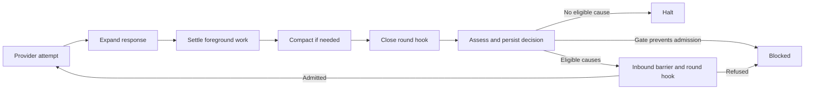

# ReAct / CodeAct round lifecycle

Every model response ends at a durable decision boundary. Another model invocation
requires at least one eligible positive continuation cause. No cause means halt;
halt alone does not claim that the user's task is complete.

## Ownership and phases

`CompletionJob` owns one provider attempt. Its expectation settling means the
provider has finished; it does not mean the response has been expanded into work.
`responseWork` records admitted calls in processing order, and `responseExpanded`
records that expansion has finished. These are references to turn-owned jobs,
not additional owners.

The iterator expands the response, settles its foreground work, performs any
required context compaction, closes the round hook, and reaches `ReACTChunk`.
This existing wire type now represents a settlement/decision boundary. Merely
creating one does not authorize a model invocation.

`round-boundary.ts` detects facts and obtains an optional bounded intent assessment.
`decideRound` in harness-model is the pure policy function: it assesses budgets,
unions eligible causes, applies gates, and defaults to halt. The iterator commits
that decision, then handles admission through the inbound barrier and round hook.
The admitted `CompletionJob` and the boundary's `successor` reference are committed together by a Plexus syncing action. `decision.nextRoundId` projects that reference's UUID after materialization; older documents can still carry the ID in their decision JSON.

## Positive causes

| Cause | Evidence | Allowance without successful work or new user steering |
| --- | --- | --- |
| Input | Unclaimed steering or notices | New events authorize a round |
| Observation | Tool / CodeAct jobs declaring `triggersReactLoop` | Successful work is progress; failed work permits 4 repair rounds |
| Call repair | Rejected or truncated calls | 4 repair rounds |
| Length repair | Output limit with partial speech and no executable work or rejected calls | Turn's stamped `lengthContinuations` setting; default 3 |
| Thought repair | Reasoning without an answer | 8 repair rounds |
| Auxiliary repair | Empty response with only metadata/context operations | 4 repair rounds |
| Callback | An outstanding agent request that this turn owes a response to | 4 reminder rounds |
| Intent | Judge positively detects promised work | 2 continuation rounds |
| Plugin | A nonempty activating context note | Each new activating note can request a round |
| User | Explicit continue command | One grant |
| Recovery | An interrupted provider attempt requiring a new attempt | One grant; existing attempt is never replayed |

All applicable causes are recorded. A negative detector does not veto another
positive cause. The intent judge runs only when cheaper facts have not already
authorized continuation. It may still classify a final response after the intent
allowance is spent: a genuine final answer or user question is distinct from an
exhausted promise to act.

Budgets count admitted bounded causes since successful work or claimed steering;
switching between failed-call, reasoning and length repairs does not reset them.
Metadata and rejected calls are not successful work. A successful tool receipt is
an operational progress signal, not proof of semantic progress: repeated successful
but unhelpful tools still require a configured `maxRounds` limit to bound them.

Ambient plugin notes enrich an already-authorized round. They cannot create one.
`context_need` describes context requirements and cannot seal the loop. Compaction
changes context and cannot create an invocation. A CodeAct job uses the same
declared follow-up contract as other tools, rather than receiving special treatment
because of its class.

## Gates and terminal meaning

Provider failure, content filtering, output exhaustion with no answer, missing
connection, the stamped turn-wide round limit, and plugin refusal are explicit
gates. A blocked decision retains the causes that requested continuation.

A budget-only stop records exhausted assessments and an explanatory turn notice.
Blocked and budget-exhausted turns remain incomplete. Intent judging returns
`judged`, `disabled`, `unconfigured`, `unsupported`, `failed`, or `invalid` status;
judge errors are not converted into a successful final-answer judgment. The assessor races its production deadline independently of provider abort cooperation. Failed,
invalid and unsupported assessments leave the turn eligible for manual continuation.

Cancellation and rewind remain turn-lifecycle operations. Parking is suspension,
not a terminal decision. Waiting on inbound work or a round hook records
`waitingFor` on the boundary and does not consume another model invocation.

## Recovery and atomicity

- Park during provider I/O: use existing unknown-outcome handling and an explicit
  recovery grant for a fresh attempt. Never replay the same provider attempt.
- Park after provider success or during early metadata: re-enter response expansion
  and reuse `responseWork`; do not re-admit already-recorded calls.
- Park while deciding: re-enter the boundary. Reuse a persisted intent assessment
  if it completed; do not treat an aborted assessment as a judgment.
- Park after decision but before admission: reuse the decision and recorded plugin
  context, even in a new runtime with an empty note log.
- Park after admission: `nextRoundId` and the queued completion identify the single
  successor. Re-entering that boundary cannot mint another successor.

Inbox facts are refreshed synchronously at decision commit so input arriving while
the judge runs cannot be sealed over. Claimed steering/notices remain on the tape.
The source response, causes, budget assessments, judge status, terminal reason,
waiting phase, and successor ID provide the audit trail for unexpected stops.

Existing documents without decisions retain a narrow legacy-token adapter.
Legacy presentation flags are still written, but new policy and recovery read the
typed decision. Legacy tape-counting and failure-collapsing test helpers have been removed.

Response admission plus its expansion cursor, completed expansion plus its boundary
and any forced compaction, decision plus terminal notice, and successor plus its authorization reference each
use a model syncing action. MobX actions alone do not make Yjs updates atomic.

Plugin admission follows canonical work reachability (`walkWork(session)`), including nested turns and the background work retained by `root.work`. An admitted tool keeps its post-hook lease while its origin subtree remains in retained session ancestry, including after background completion removes it from scheduling; rewinding that origin away revokes the lease. Plugin pre/post hooks and guards have execution deadlines. Timeout, cancellation, park, or rewind prevents their late state writes, notifications, and host-effect entry. A human permission wait does not consume the plugin execution deadline. Completed worker calls join their bounded plugin finalizers before the turn records its plugin-state snapshot.

## Regression contract

`continuation-architecture.test.ts` exercises the real Kernel, Project and Session
Daemon with a controlled provider connection. It covers combined causes, ambient
notes, input during judgment, public cancel/rewind, retry budgets and progress,
CodeAct contracts, and replica-visible blocked/incomplete decisions. It rehydrates
every Yjs update of a live turn to check durable structural invariants, saves
provider-settled, partially-expanded, undecided, decided and admitted prefixes,
and reopens those images through DocumentService in fresh daemons. A real
`edit_file` result verifies that recovering settled tool work does not repeat its
filesystem edit; terminal images remain stable over two further restarts. Another trace restarts
twice during provider I/O and verifies one explicit recovery grant per abandoned
attempt. This
is a bounded recovery trace, not an exactly-once guarantee for effects dispatched
without a durable receipt.

The intent suites send valid, invalid, failed and unsupported judge responses
through the provider port and check persisted assessments plus replica state.
An abort-ignoring provider exercises the real 30-second deadline and late-result
suppression. Iterator tests retain isolated sequencing contracts; they do not
manually stamp reducer exit to impersonate a live lifecycle. The reducer wiring
story asserts each phase before proceeding to the next.

Provider tests own abnormal wire termination: chat streams require an explicit
finish reason and settle at that terminal event; empty JSON, role-only chat frames,
and lifecycle heartbeats do not extend the no-progress deadline. Responses bulk
and SSE replies recognize the same output-limit/filter reasons and fail on failed,
missing or unknown terminal states. A forced-compaction recovery trace also checks
that the queued compact and its source expansion are one durable update. Surrounding compaction,
cancellation, plugin and recovery suites cover their distinct consumer contracts.
